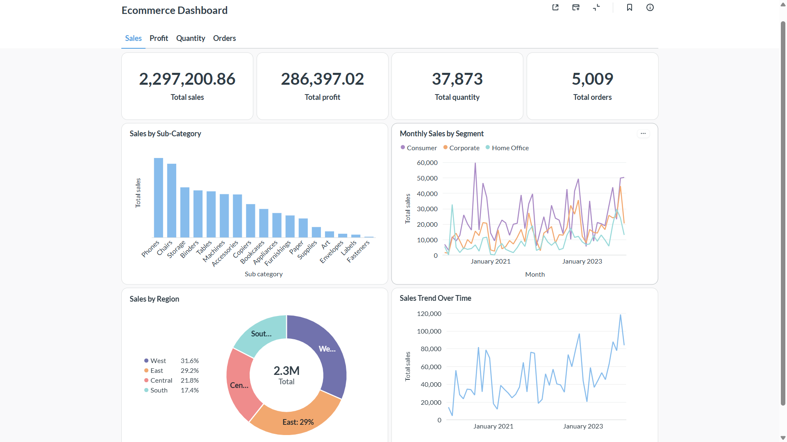
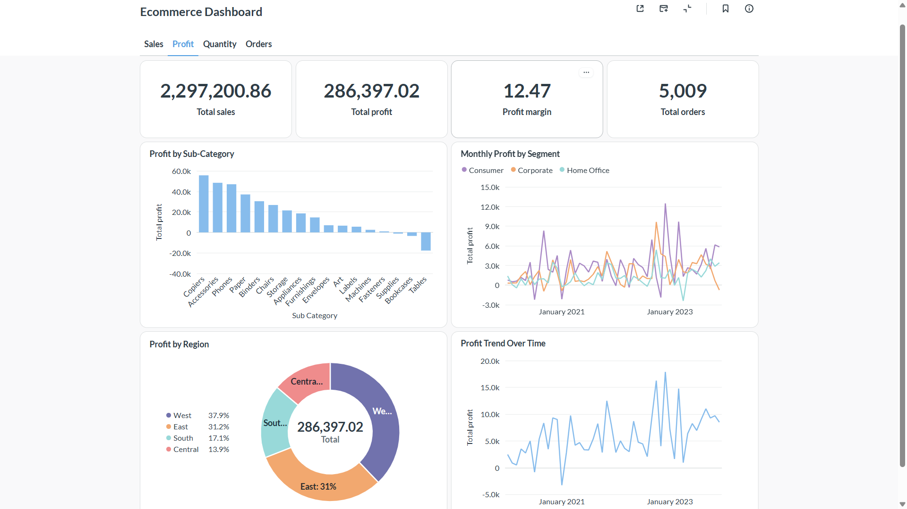
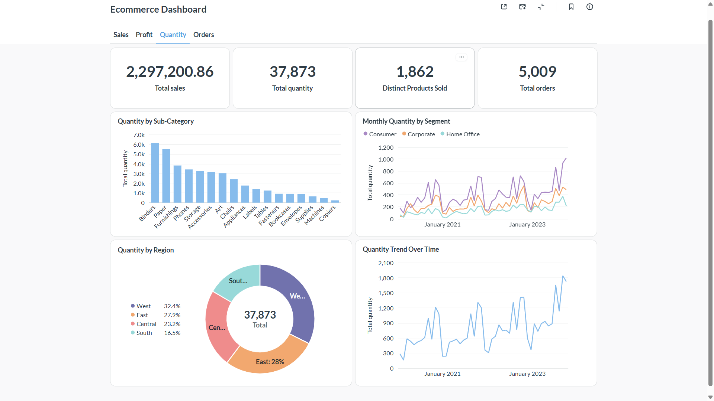
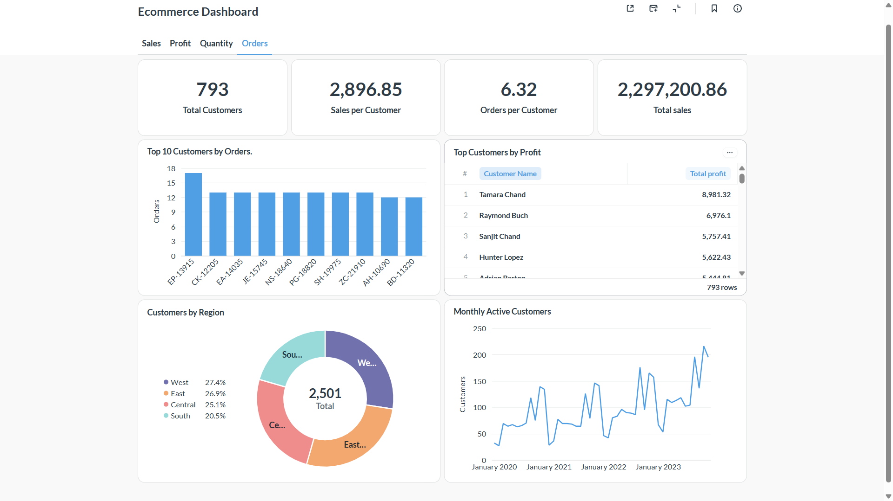

# E-commerce Sales Pipeline

An end-to-end data engineering project that transforms raw e-commerce data into structured PostgreSQL tables and interactive business intelligence dashboards. The project demonstrates data profiling, data cleaning, ETL development, relational database design, Docker containerization, data validation, and business analytics.

**Technologies:** Python · pandas · PostgreSQL · SQL · Docker · Docker Compose · Metabase · Git

[View the GitHub Repository](https://github.com/Ohenedarkoh/ecommerce-sales-pipeline)

## Project Overview

The project processes four datasets — Customers, Locations, Products, and Orders — using Python and pandas, loads the processed data into PostgreSQL, and exposes the data through Metabase dashboards.

The objective was to build a practical data pipeline that demonstrates how raw datasets can be transformed into structured data for business analysis.

## Architecture

```text
Raw CSV Files
     |
     v
Python ETL Pipeline
(Extract, Transform, Load)
     |
     v
PostgreSQL Database
     |
     v
Metabase Dashboards
     |
     +-- Sales Performance
     +-- Profitability Analysis
     +-- Product & Demand
     +-- Customer & Order Insights
```

Docker Compose manages the PostgreSQL database, ETL application, and Metabase services.

## Technology Stack

| Technology | Purpose |
|---|---|
| Python and pandas | Data extraction, cleaning, and transformation |
| PostgreSQL | Relational database storage |
| SQL | Database schema and analytical queries |
| Docker | Application containerization |
| Docker Compose | Service orchestration |
| Metabase | Data exploration and dashboards |
| Git and GitHub | Version control and project hosting |
| pytest | Python testing framework |

## Dashboard Previews

### 1. Sales Performance



| KPI | Value |
|---|---:|
| Total Sales | $2,297,200.86 |
| Total Profit | $286,397.02 |
| Total Quantity | 37,873 |
| Total Orders | 5,009 |

**Key insights**
- The West and East regions contribute 60.8% of reported sales combined.
- The Consumer segment records the highest monthly sales among the three customer segments.
- Sales exhibit seasonal peaks toward the end of the reporting period, with a monthly peak approaching $120,000.
- Phones and Chairs rank among the leading sub-categories by sales, while Envelopes, Labels, and Fasteners are among the lowest.

### 2. Profitability Analysis



| KPI | Value |
|---|---:|
| Total Profit | $286,397.02 |
| Total Sales | $2,297,200.86 |
| Profit Margin | 12.47% |
| Total Orders | 5,009 |

**Key insights**
- The West contributes 37.9% of reported profit, compared with 31.6% of sales.
- The Central region contributes 21.8% of sales but 13.9% of profit, suggesting an area worth investigating for differences in discounts, product mix, or costs.
- Copiers, Accessories, and Phones are among the strongest reported sub-categories by profit.
- Tables and Bookcases show negative reported profit, indicating that their profitability warrants further investigation.

### 3. Product & Demand



| KPI | Value |
|---|---:|
| Total Quantity | 37,873 |
| Distinct Product IDs Sold | 1,862 |
| Total Orders | 5,009 |
| Total Sales | $2,297,200.86 |

**Key insights**
- Binders and Paper lead reported unit demand, while Copiers and Machines record lower unit volumes.
- The Consumer segment contributes the highest monthly quantity sold.
- Monthly quantity sold generally increases toward the end of the reporting period.
- The dashboards illustrate how high-volume office supplies and lower-volume products can have different sales and profitability profiles.

### 4. Customer & Order Insights



| KPI | Value |
|---|---:|
| Distinct Customers | 793 |
| Sales per Customer | $2,896.85 |
| Orders per Customer | 6.32 |
| Total Sales | $2,297,200.86 |

**Key insights**
- The highest-order-count customer records approximately 17 orders, while the remaining customers in the displayed top 10 record around 12–13 orders each.
- Tamara Chand leads the displayed customer profit ranking at $8,981.32, followed by Raymond Buch at $6,976.10.
- The regional customer chart appears more evenly distributed than the reported regional sales distribution.
- Monthly active customer counts fluctuate over time, reaching more than 200 near the end of the reporting period.

## Data Engineering Workflow

### 1. Data exploration and cleaning

The four source datasets were profiled to identify missing values, duplicate records, malformed product records, and identifier-related issues. Cleaning decisions were made to preserve valid data while addressing structural problems.

### 2. Database design

PostgreSQL stores the processed data in four tables:

- `customers`
- `locations`
- `products`
- `orders`

The schema defines primary keys and relationships between orders, customers, and locations.

### 3. ETL pipeline

The Python pipeline extracts the source data, applies the required processing, and loads the results into PostgreSQL.

### 4. Containerization

Docker Compose manages the database, ETL application, and Metabase services. Environment-specific configuration is kept outside the application code.

### 5. Analytics and visualization

Metabase connects to PostgreSQL to support data exploration, KPI reporting, comparisons, and dashboard-based business analysis.

## Data Validation Results

The loaded PostgreSQL tables matched the expected source row counts.

| Table | Rows |
|---|---:|
| Customers | 793 |
| Locations | 632 |
| Products | 1,894 |
| Orders | 9,994 |

These checks confirm that the expected number of rows was loaded into each table. They do not independently establish the correctness of every join or analytical aggregation.

## Running the Project

### Prerequisites

- Git
- Docker Desktop with Docker Compose
- The required source CSV files

### 1. Clone the repository

```bash
git clone https://github.com/Ohenedarkoh/ecommerce-sales-pipeline.git
cd ecommerce-sales-pipeline
```

### 2. Configure the environment

Create a local `.env` file using the variable names and database settings expected by the project's ETL pipeline and `compose.yaml`.

Do not commit credentials or raw data to GitHub.

### 3. Add the source data

Place the required CSV files in the expected local data directory. The default ETL data path is `data/raw`.

### 4. Start PostgreSQL and Metabase

```bash
docker compose up -d --build postgres metabase
```

### 5. Run the ETL pipeline

```bash
docker compose --profile run-etl run --rm etl
```

### 6. Access Metabase

Open [http://localhost:3000](http://localhost:3000) in your browser.

The Compose configuration maps PostgreSQL to host port `5433` to avoid a conflict with a local PostgreSQL service using port `5432`.

For detailed setup instructions and additional Docker commands, see [Docker and Metabase](docs/05-docker-and-metabase.md).

## Known Limitations

**Product identifier ambiguity:** The Products dataset contains repeated Product IDs associated with different product names. Joining Orders to Products using Product ID alone may create multiple matches and inflate product-level sales, profit, or quantity. Product-level findings should be treated as provisional until the identifier and join logic are validated.

**Regional customer counts:** Customers may be associated with more than one region in the underlying order records. Regional customer counts must use an appropriate distinct-customer definition, and regional totals should not automatically be interpreted as unique customers nationally.

**Business interpretation:** The available data does not independently explain the causes of negative profit, seasonal changes, or regional margin differences. These patterns indicate areas for further investigation rather than definitive explanations.

## Documentation

Detailed documentation is available in the `docs/` directory.

| Document | Description |
|---|---|
| [01 — Project Design and Git](docs/01-project-design-and-git.md) | Objectives, architecture, repository structure, and Git workflow |
| [02 — Data Exploration and Cleaning](docs/02-data-exploration-and-cleaning.md) | Profiling findings and cleaning decisions |
| [03 — Database and ETL](docs/03-database-and-etl.md) | PostgreSQL schema, loading, and ETL workflow |
| [04 — Code Quality and Configuration](docs/04-code-quality-and-configuration.md) | Configuration, logging, validation, and testing |
| [05 — Docker and Metabase](docs/05-docker-and-metabase.md) | Container setup, commands, and dashboards |
| [06 — SQL Analysis and Release](docs/06-sql-analysis-and-release.md) | Analytical questions, data quality considerations, and release workflow |

## Future Improvements

- Resolve product identifier ambiguity and validate product-level aggregations.
- Expand automated tests for transformations and pipeline behavior.
- Strengthen data quality checks and failure reporting.
- Introduce scheduled pipeline execution.
- Explore integration with a cloud data warehouse.

## Author

**Frank Ohene-Darkoh**

[GitHub Profile](https://github.com/Ohenedarkoh) · [Project Repository](https://github.com/Ohenedarkoh/ecommerce-sales-pipeline)